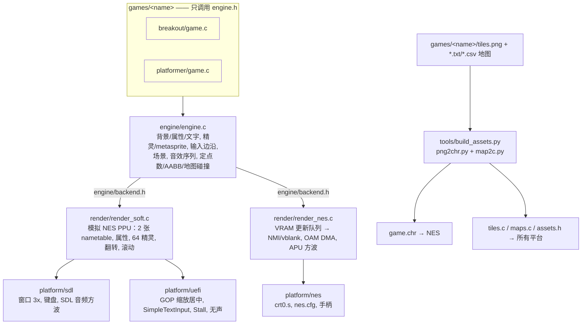

# retro_engine —— 可移植的 2D 复古小引擎（PC/SDL2 · UEFI 裸机 · NES）

**游戏逻辑在各平台上完全相同，只有构建方式不同。** 引擎和游戏都用 C89 编写（可以用 cc65 编译），只用整数和定点数，不使用 malloc。所有限制以 NES 为准：屏幕 256x240、8x8 tile、最多 64 个精灵、2KB RAM、NTSC 60Hz。

> ⚠️ 压缩包里已经带了预编译文件。`make` 会**跳过已经是最新的输出**；如果想从头完整重新编译，请先执行 `make clean`。

## 架构


## 目录结构
```
engine/   engine.h（公开 API） backend.h（后端接口） engine.c
render/   render_soft.c/.h（PC 和 UEFI 共用） render_nes.c
platform/ sdl/main_sdl.c  uefi/main_uefi.c  nes/{main.c,crt0.s,nes.cfg,nes.h}
games/    breakout/{game.c,tiles.png,play.txt}  platformer/{game.c,tiles.png,level.txt}
tools/    build_assets.py png2chr.py map2c.py make_sheets.py mkimg.sh fceux_test.lua qemu_test.sh
lib/      none.lib（cc65 运行库副本，用于离线编译）
build/<game>/{pc,uefi,nes,gen}/   编译输出
shots/    测试截图
```

## 平台限制（以 NES 为准）
| 项目 | 限制 |
|---|---|
| 屏幕 | 256x240；背景 64x30 tile（两屏宽），支持水平滚动 0..511 |
| 颜色 | 4 组背景调色板 + 4 组精灵调色板，每组 3 色 + 公共背景色；背景调色板按 16x16 区块设置 |
| 精灵 | 8x8，每帧最多 64 个；NES 上**同一扫描线最多 8 个**，超出的会消失 |
| RAM | 2KB：$0200 是 OAM，$0300 是 VRAM 队列，$0700 是 C 栈；游戏和引擎变量放在 $0400-$06FF（breakout 用了 283 字节，platformer 用了 214 字节） |
| VRAM 写入 | 每帧大约 96 字节，超出时引擎会等一帧（掉一帧）；在场景 `init` 里写入不受限制（此时渲染已关闭） |
| ROM | NROM：32KB PRG + 8KB CHR（256 个 tile，背景和精灵共用） |
| 数值 | 整数；`fx` 是 12.4 定点数（范围 ±2047 像素）；cc65 的 `int` 是 16 位 |

## 引擎 API 参考（engine/engine.h）
**类型**：`u8 s8 u16 s16`，`fx`（12.4 定点数），`FX(n)` 把整数转成定点数，`FX_INT(v)` 把定点数转回整数。

**背景**
- `gfx_palette(const u8 pal[32])`：设置调色板（NES 颜色编号）
- `bg_tile(x,y,t)`、`bg_tiles(x,y,ptr,n)`、`bg_fill(x,y,w,h,t)`：写入 tile（会排队，x 范围 0..63）
- `bg_attr(x,y,pal)`：设置 tile (x,y) 所在 16x16 区块的调色板
- `bg_text(x,y,"TEXT")`、`bg_number(x,y,value,digits)`：显示文字和数字（tile 编号就是 ASCII 码）
- `bg_load(map,w,h,attr)`：批量载入地图（**只能在场景 init 里调用**）
- `bg_scroll(x)`：水平滚动

**精灵**（每帧画之前会自动清空）
- `spr(x,y,tile,attr)`：attr = 调色板 0..3 | `SPR_FLIPH` | `SPR_FLIPV` | `SPR_BEHIND`，超出屏幕的会被裁掉
- `spr_meta(x,y,def,flip)`：def 格式是 `{dx,dy,tile,attr,..., -128}`
- `spr_text`、`spr_number`：用精灵显示文字，适合做滚动画面上的 HUD

**输入**：`pad_held` / `pad_pressed` / `pad_released` 三个位掩码，按键为 `BTN_UP/DOWN/LEFT/RIGHT/A/B/START/SELECT`

**场景**：`Scene {init, update, draw}`，`scene_go(&scene)` 在下一帧开始时切换。游戏要提供 `game_boot()`（返回第一个场景）和 `game_autopilot()`（PC 测试模式下的自动输入）。

**音效**：`sfx(SFX_BLIP|HIT|COIN|JUMP|LOSE|WIN)`，用一个方波通道。NES 用 APU pulse1，PC 用 SDL 音频，UEFI 没有声音。

**物理**：`aabb(ax,ay,aw,ah,bx,by,bw,bh)`，`tm_bind(map,w,h,flags)`，`tm_flags_at(px,py)`（返回 `TF_SOLID`，地图左右和上方之外都算实心），`rnd()`。全局变量 `frame_count`。

## 一步一步做一个新游戏
1. `mkdir games/mygame`
2. 画 tile 表 `tiles.png`：宽 128，高不超过 128，共 16x16 个 8x8 tile，tile 编号按行排列。只能用 4 种灰度：黑=0、85 灰=1、170 灰=2、白=3，分别对应调色板里的颜色编号。字体放在 ASCII 码对应的位置；可以运行 `python3 tools/make_sheets.py breakout games/mygame/tiles.png` 生成一张带字体的起始图。
3. 做地图（可选）：
   - 文本格式 `level.txt`：
     ```
     legend:
     ; 字符 tile 编号 [pal=N] [solid]
     . 0x20 pal=0
     # 0x80 pal=1 solid
     map:
     ######....
     ```
   - 或者用 Tiled 导出 CSV `level.csv`，再写一个配套的 `level.legend`（每行格式：`tile [pal=N] [solid]`）
   - 生成的代码包括 `map_level[]`、`map_level_attr[]`、`map_level_flags[]`，以及 `MAP_LEVEL_W/H`
4. 写 `game.c`：只 `#include "../../engine/engine.h"` 和 `"assets.h"`，实现场景、`game_boot()`、`game_autopilot()`。
5. `make GAME=mygame pc`（以及 uefi、img、nes、all）

**保持可移植的规则**：不使用 `#ifdef 平台`、浮点数、malloc、libc；变量声明放在代码块开头（C89）；大的常量数据加 `const`（会放进 ROM）；每帧的背景修改要少（大改动放在场景 init 里做）；HUD 如果要跟着滚动，就用精灵来画。

## 添加一个新平台
1. 帧缓冲类平台：复用 `render_soft.c`。平台层负责：`engine_init()` → 每 1/60 秒调用 `engine_frame(按键位掩码)` → `soft_compose(fb)` → 显示；音频读取 `soft_snd_period/vol`。
2. tile 硬件类平台（GB、SMS、PCE…）：照着 `render_nes.c` 实现 `backend.h` 里的函数（`r_init r_palette r_tiles r_attr r_scroll r_bulk_begin/end r_oam snd_hw`）。
3. 在 Makefile 里加一个 target，把 `engine/engine.c`、`games/$(GAME)/game.c` 和生成的资源编进去。

## 资源流程
`tools/build_assets.py games/<g> build/<g>/gen` 会生成：
- `game.chr`：8KB 的 NES 图案表（ca65 通过 `.incbin` 引入）
- `tiles.c`：`chr_tiles[4096]`，内容和 CHR 一样，给软件渲染器用
- `maps.c` 和 `assets.h`：地图、属性表、碰撞标志

所以每个游戏只有一份图形源（`tiles.png`）和一份地图源，三个平台的画面完全对应。`make` 会自动运行这一步。

## 在 Ubuntu 26.04 上安装和编译
```sh
sudo apt install build-essential python3 python3-pil libsdl2-dev gnu-efi mtools dosfstools \
                 qemu-system-x86 ovmf cc65 fceux
# 如果 26.04 上没有 libsdl2-dev，改装 libsdl2-compat-dev（提供同样的 sdl2-config 和头文件）
make GAME=breakout   pc|uefi|img|nes|all
make GAME=platformer pc|uefi|img|nes|all
make games-all       # 两个游戏 × 所有平台
make clean           # 删除 build/（想完整重新编译时先执行它）
```
输出文件：`build/<game>/pc/<game>`、`build/<game>/uefi/BOOTX64.EFI` 和 `<game>.img`、`build/<game>/nes/<game>.nes`

## 运行
- PC：`./build/platformer/pc/platformer`
  - 测试模式：`RETRO_TEST=shots/x RETRO_SHOT_A=60 RETRO_SHOT_B=600 ./build/breakout/pc/breakout`
- UEFI：
  ```sh
  qemu-system-x86_64 -m 256 -net none \
    -drive if=pflash,format=raw,readonly=on,file=/usr/share/OVMF/OVMF_CODE_4M.fd \
    -drive if=pflash,format=raw,file=$(cp /usr/share/OVMF/OVMF_VARS_4M.fd /tmp/v.fd; echo /tmp/v.fd) \
    -drive format=raw,file=build/breakout/uefi/breakout.img
  ```
  写入 U 盘（**会清空设备**）：`sudo dd if=build/breakout/uefi/breakout.img of=/dev/sdX bs=4M conv=fsync status=progress`，关闭 Secure Boot，以 UEFI 方式启动。
- NES：`fceux build/platformer/nes/platformer.nes`，也可以用 Mesen；真机可以用 EverDrive 等烧录卡（mapper 0 / NROM）。
- 自动测试：`tools/qemu_test.sh <game> shots/uefi_<game>`；`RETRO_GAME=<game> RETRO_SHOTS=$PWD/shots/nes_<game> fceux --loadlua tools/fceux_test.lua build/<game>/nes/<game>.nes`（无界面时需要配合 Xvfb）

## 操作
| 手柄 | PC 键盘 | UEFI 键盘 | NES |
|---|---|---|---|
| 方向 | 方向键 / WASD | 方向键 / wasd | 十字键 |
| A（跳跃、发球） | Z / 空格 | 空格 / z | A |
| B | X | x | B |
| Start | Enter | Enter | Start |
| Select | 右 Shift / Tab | Tab | Select |
| 退出 | Esc | Esc | — |

Breakout：左右移动挡板，A 或 Start 发球。Platformer：左右跑动，A 跳跃（按得越久跳得越高），踩敌人可以把它消灭，收集全部 6 枚金币就胜利，掉进坑里会损失一条命。

## 已知限制
- UEFI 没有“按键松开”事件：引擎会在按键事件之后把它当作按住几帧（方向键 8 帧），持续按住要靠键盘自动重复。UEFI 版没有声音。
- NES 每条扫描线最多 8 个精灵，背景色块是 16x16；fceux 默认会裁掉画面最上和最下各 8 行（屏幕顶部的 HUD 会被切掉一部分）。
- 软件渲染器的 RGB 调色板和 fceux 的不完全一样，颜色会略有差异。
- 修改背景 tile 不会自动更新碰撞地图（`tm_bind` 绑定的是 ROM 里的地图）。
- 只支持水平滚动，最多两屏（512 像素）；没有画面分割，所以滚动场景的 HUD 要用精灵来画。
