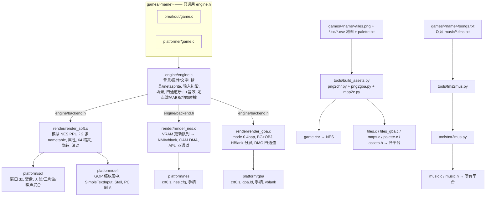

# retro_engine —— 可移植的 2D 复古小引擎（PC/SDL2 · UEFI 裸机 · NES · GBA）

**游戏逻辑在各平台上完全相同，只有构建方式不同。** 引擎和游戏都用 C89 编写（可以用 cc65 编译），只用整数和定点数，不使用 malloc。所有限制以 NES 为准：屏幕 256x240、8x8 tile、最多 64 个精灵、2KB RAM、NTSC 60Hz。

> ⚠️ 压缩包里已经带了预编译文件。`make` 会**跳过已经是最新的输出**；如果想从头完整重新编译，请先执行 `make clean`。

## 架构


## 目录结构
```
engine/   engine.h（公开 API） backend.h（后端接口） engine.c
render/   render_soft.c/.h（PC 和 UEFI 共用） render_nes.c  render_gba.c
platform/ sdl/main_sdl.c  uefi/main_uefi.c  nes/{main.c,crt0.s,nes.cfg,nes.h}  gba/{main_gba.c,crt0.s,gba.ld,gba.h}
games/    breakout/{game.c,tiles.png,palette.txt,play.txt,songs.txt,music/*.fms.txt,fami/*.fms.txt}  platformer/ 同样
editor/   桌面编辑器（图块、调色板、地图、音乐、编译运行）。见 editor/README.md
tools/    build_assets.py png2chr.py png2gba.py gbafix.py map2c.py txt2mus.py fms2mus.py songs2fms.py make_sheets.py mkimg.sh uefi_probe.sh uefi_link.sh fceux_test.lua qemu_test.sh
lib/      none.lib（cc65 运行库副本，用于离线编译）
build/<game>/{pc,uefi,nes,gba,gen}/   编译输出
shots/    测试截图
```

## 平台限制（以 NES 为准）
| 项目 | 限制 |
|---|---|
| 屏幕 | 256x240；背景 64x30 tile（两屏宽），支持水平滚动 0..511 |
| 颜色 | 4 组背景调色板 + 4 组精灵调色板，每组 3 色 + 公共背景色；背景调色板按 16x16 区块设置 |
| 精灵 | 8x8，每帧最多 64 个；NES 上**同一扫描线最多 8 个**，超出的会消失 |
| RAM | 2KB：$0200 是 OAM，$0300 是 VRAM 队列，$0700 是 C 栈；游戏和引擎变量放在 $0400-$06FF（breakout 的 BSS 是 333 字节，platformer 是 264 字节，含大约 40 字节乐曲状态） |
| 音频 | 4 通道：两路方波、三角波、噪声；没有 DPCM。音效占用 pulse2 |
| VRAM 写入 | 每帧大约 96 字节，超出时引擎会等一帧（掉一帧）；在场景 `init` 里写入不受限制（此时渲染已关闭） |
| ROM | NROM：32KB PRG + 8KB CHR（256 个 tile，背景和精灵共用） |
| 数值 | 整数；`fx` 是 12.4 定点数（范围 ±2047 像素）；cc65 的 `int` 是 16 位 |

## 引擎 API 参考（engine/engine.h）
**类型**：`u8 s8 u16 s16`，`fx`（12.4 定点数），`FX(n)` 把整数转成定点数，`FX_INT(v)` 把定点数转回整数。

**背景**
- `gfx_palette(const u8 pal[32])`：设置调色板（NES 颜色编号）。每个游戏的 32 色写在 `palette.txt`，编译后变成 `game_palette`
- `bg_tile(x,y,t)`、`bg_tiles(x,y,ptr,n)`、`bg_fill(x,y,w,h,t)`：写入 tile（会排队，x 范围 0..63）
- `bg_attr(x,y,pal)`：设置 tile (x,y) 所在 16x16 区块的调色板
- `bg_text(x,y,"TEXT")`、`bg_number(x,y,value,digits)`：显示文字和数字（tile 编号就是 ASCII 码）
- `bg_load(map,w,h,attr)`：批量载入地图（**只能在场景 init 里调用**）
- `bg_scroll(x)`：水平滚动

**精灵**（每帧画之前会自动清空）
- `spr(x,y,tile,attr)`：attr = 调色板 0..3 | `SPR_FLIPH` | `SPR_FLIPV` | `SPR_BEHIND`，超出屏幕的会被裁掉
- `spr_meta(x,y,def,flip)`：def 格式是 `{dx,dy,tile,attr,..., -128}`
- `spr_text`、`spr_number`：用精灵显示文字，适合做滚动画面上的 HUD

**输入**：`pad_held` / `pad_pressed` / `pad_released` 三个位掩码，按键为 `BTN_UP/DOWN/LEFT/RIGHT/A/B/START/SELECT`

**场景**：`Scene {init, update, draw}`，`scene_go(&scene)` 在下一帧开始时切换。游戏要提供 `game_boot()`（返回第一个场景）和 `game_autopilot()`（PC 测试模式下的自动输入）。

**音频**：四个通道同时出声（方波、方波、三角波、噪声）。`music_play` / `music_stop` / `music_pause` / `music_volume` 播循环乐曲，`sfx(SFX_BLIP|HIT|COIN|JUMP|LOSE|WIN)` 暂时占用第二路方波，结束后那一路乐曲继续。详见下面的「音频」。

**物理**：`aabb(ax,ay,aw,ah,bx,by,bw,bh)`，`tm_bind(map,w,h,flags)`，`tm_flags_at(px,py)`（返回 `TF_SOLID`，地图左右和上方之外都算实心），`rnd()`。全局变量 `frame_count`。

## 音频

乐曲和音效同时播放。模型就是 NES APU 的前四个通道，没有 DPCM。游戏代码和 `engine.c` 里没有平台 `#ifdef`，只用整数，每帧（60Hz）走一步。

| 通道 | 波形 | 谁在用 |
|---|---|---|
| pulse1 | 方波，占空比 12.5/25/50/75% | 乐曲主旋律 |
| pulse2 | 方波 | 乐曲和声；`sfx()` 临时占用，结束后回到乐曲 |
| triangle | 三角波 | 低音。NES 上没有音量，只有开和关 |
| noise | 15 位 LFSR | 打击乐。`mode 1` 是短模式 |

音高用 NTSC 的 APU 周期：方波频率是 `1789773/16/(period+1)`，三角波是 `1789773/32/(period+1)`。SDL 用同一组周期去合成，所以和 NES 是同一个调。

**API**（`engine/engine.h`）

- `music_play(MUS_TITLE)`：从头播放。`MUS_*` 由 `songs.txt` 里的 `song` 名字生成。
- `music_stop()`：停掉乐曲。正在响的音效会继续。
- `music_pause(1)` 暂停并保持当前音符，`music_pause(0)` 继续。
- `music_volume(0..15)`：只缩小乐曲。音效不跟着变。默认 12。
- `sfx(SFX_BLIP|HIT|COIN|JUMP|LOSE|WIN)`：和原来的编号一样，占 pulse2，音量比乐曲和声高。

两个示例的标题画面播 `MUS_TITLE`，局内播 `MUS_PLAY`，结束画面停乐，胜利/失败音效盖在最后一拍上。

**songs.txt**

```
song title
tempo 128

pulse1 duty 2 vol 10
  E5 8 G5 8 A5 8 G5 8
  loop
  C5 4 E5 4

pulse2 duty 1 vol 5
  C4 4 E4 4

triangle vol 15
  C3 2 G2 2

noise vol 6 mode 0
  N1 8 N12 8
```

- `tempo` 是四分音符的 BPM。八分音符正好是它的一半（四分音符帧数会取整，写十六分音符时最好让这个帧数能被 4 整除，例如 tempo 120 → 30 帧，tempo 128 → 28 帧，tempo 150 → 24 帧）。
- 音符：`C4` `C#4` `Bb3`，音域 C1–B7。`R` 或 `-` 是休止。
- 时值：`1` 全音符、`2` 二分、`4` 四分、`8` 八分、`16` 十六分、`32` 三十二分。`8.` 是附点八分。`t12` 表示正好 12 帧。
- `loop` 单独一行：它上面的是前奏，只播一次；下面的反复。不写 `loop` 就整段循环。通道行上写 `once` 则播完就停。
- 噪声只用 `N0`（最高、最尖）到 `N15`（最低）。`mode 1` 切换短 LFSR。
- 四个通道各自循环。总帧数不一样时，`txt2mus.py` 会警告，听起来会慢慢错开。
- `duty` 只对方波有意义：0 = 12.5%，1 = 25%，2 = 50%，3 = 75%。`vol` 是 0..15。

`make` 先用 `tools/fms2mus.py` 把 `songs.txt` 和 FamiStudio 文本合成 `build/<游戏>/gen/songs.gen.txt`，再调用 `tools/txt2mus.py` 生成 `music.c` 和 `music.h`（里面有 `MUS_TITLE` 这类宏，以及 `music_lookup()`）。`songs.txt` 里的歌排在前面。

**写一首新曲子**

1. 在 `games/<游戏>/songs.txt` 里加一段 `song mytune`，或者用下面的 FamiStudio 流程。
2. 先写 pulse1 的旋律，再让 pulse2、triangle、noise 的总时值和它相同。
3. `make GAME=<游戏> pc`，用耳机听。想只录声音：`RETRO_WAV=tune.wav RETRO_TEST=/tmp/shot ./build/<游戏>/pc/<游戏>`。
4. 在场景 `init` 里调用 `music_play(MUS_MYTUNE)`。

**用 FamiStudio 写曲子**

FamiStudio 是原生桌面程序（Linux 上用 .NET 启动，也有 Flatpak）。四个旋律通道和引擎一一对应：Square1 → pulse1，Square2 → pulse2，Triangle → triangle，Noise → noise。

在 Ubuntu 上安装官方压缩包：

```sh
sudo apt install dotnet-runtime-8.0
# 从 https://famistudio.org/ 或 GitHub Releases 下载 FamiStudio453-LinuxAMD64.zip（4.5.x）
unzip FamiStudio453-LinuxAMD64.zip -d ~/FamiStudio
cd ~/FamiStudio && dotnet FamiStudio.dll
```

Flatpak 会自己带上依赖：`flatpak install flathub org.famistudio.FamiStudio`。文本格式跨小版本不兼容，打开工程时看 Project 行的 `Version`。这里的示例是 `4.5.3`。

在引擎能播的范围内作曲：

- 只用 Square1、Square2、Triangle、Noise。速度用 FamiStudio 模式，Groove 最好只写一个数（例如 `10`），这样一行就是固定的 NTSC 帧数，导入后时值是准的。两个数的摇摆 groove 会按播放器的垫帧规则展开成帧；一行内部的滑音和音量变化不会。
- FamiTracker 速度也可以。tempo 150、speed 6 是每行 6 帧（NTSC）。标了 PAL 的工程仍按 60Hz 计算，听起来会偏快。
- 方波的占空比和音量来自乐器。音量包络只留下峰值，占空比包络只留下第一个值。同一个通道里混了几种音量或占空比时，留下出现最多的那个，并打印警告。
- 音符、休止、Stop、Release、pattern 的排列和 Loop point 会保留。Release 当成提前停音，不播释音包络。Loop point 是整首歌的，落在某个 pattern 列的开头。`-1` 表示每个通道只播一次。
- 一条音符在引擎里最长 255 帧。更长的会拆成几段相同音高接在一起，波形不会重新触发。

不会导入、但也不会让转换失败的内容：DPCM 采样和 DPCM 通道，扩展芯片（VRC6、VRC7、FDS、MMC5、N163、S5B、EPSM），滑音、颤音、琶音、微调音高、音量滑动。音高停在音符本身。`tools/fms2mus.py` 把这些写到标准错误。

导出并编进游戏：

1. File → Export → FamiStudio Text。
2. 保存为 `games/<游戏>/music/歌名.fms.txt`。游戏目录根下的 `*.fms.txt` 也会被捡起来。`fami/` 下面的文件不会。
3. `make GAME=<游戏> pc`。歌曲名字变成 `MUS_名字`（小写，其他字符变成下划线）。重名时会加上 `_2`，并打印警告。
4. 在场景 `init` 里调用 `music_play(MUS_...)`。

`games/breakout/music/sample.fms.txt` 是一首手写的示例，导入后是 `MUS_SAMPLE`（breakout 里排在 `MUS_TITLE`、`MUS_PLAY` 后面，编号 2）。`games/breakout/fami/breakout.fms.txt` 和 `games/platformer/fami/platformer.fms.txt` 是现有曲子导出的起点，用 FamiStudio 打开就能改。改完后导出到 `music/`，不要把这个起点本身放进 `music/`，否则会和 `title` / `play` 重名。重新生成起点：

```sh
python3 tools/songs2fms.py games/breakout/songs.txt games/breakout/fami/breakout.fms.txt
```

PC 上只听某一首、并且游戏里的 `music_play` 都改播它：`RETRO_MUS=2 RETRO_WAV=sample.wav RETRO_FRAMES=160 ./build/breakout/pc/breakout`。`RETRO_FRAMES` 按引擎帧计数。这只影响 SDL 测试，游戏代码不用调用 `music_lock`。

**四个后端**

- NES：每帧写 `$4000`–`$400F`，并打开 `$4015` 的低四位。只有音高的高 3 位变了，或者一个通道从静音变成发声时，才写 `$4003` / `$400B` / `$400F`，避免每帧重置相位发出杂音。
- SDL：回调里用同一套周期合成方波（占空比序列）、32 步三角波和噪声 LFSR，混合成 44100Hz 单声道。`RETRO_WAV=文件.wav` 时不打开声卡，改为每个引擎帧写 735 个采样。
- UEFI：PC 喇叭（端口 `0x61`，PIT 通道 2 `0x42`）。同时只能响一个音，优先级是 pulse2、pulse1、三角波，这样音效能盖过旋律。噪声不走喇叭。QEMU 需要把 PC speaker 接到音频设备，例如 `-audiodev wav,id=snd,path=uefi.wav -machine pcspk-audiodev=snd`。没有这块设备时喇叭是静音的。
- GBA：DMG 音源的四路。方波 1、方波 2 的占空比和 NES 一样（12.5/25/50/75%）。三角波写进 wave RAM，音量分成 100/50/25% 三档。噪声用最接近的多项式计数器；NES 的 `duty` 最低位是短模式。只有音高变了或者从静音变成发声时才重新触发，避免每帧咔哒一声。音效仍占方波 2。GBA 方波最低大约 64Hz，比 NES 的最低音稍高，那些音会被夹到最低。最快的噪声（N0）大约偏高 17%。

## 一步一步做一个新游戏
1. `mkdir games/mygame`
2. 画 tile 表 `tiles.png`：宽 128，高不超过 128，共 16x16 个 8x8 tile，tile 编号按行排列。只能用 4 种灰度：黑=0、85 灰=1、170 灰=2、白=3，分别对应调色板里的颜色编号。字体放在 ASCII 码对应的位置；可以运行 `python3 tools/make_sheets.py breakout games/mygame/tiles.png` 生成一张带字体的起始图。
3. 做地图（可选）：
   - 文本格式 `level.txt`：
     ```
     legend:
     ; 字符 tile 编号 [pal=N] [solid]
     . 0x20 pal=0
     # 0x80 pal=1 solid
     map:
     ######....
     ```
   - 或者用 Tiled 导出 CSV `level.csv`，再写一个配套的 `level.legend`（每行格式：`tile [pal=N] [solid]`）
   - 生成的代码包括 `map_level[]`、`map_level_attr[]`、`map_level_flags[]`，以及 `MAP_LEVEL_W/H`
4. 写 `songs.txt`，或者在 `music/` 里放 FamiStudio 文本导出（至少一首循环；`make` 会生成 `music.h`）。格式见上面的「音频」。
5. 写 `game.c`：只 `#include "../../engine/engine.h"`、`"assets.h"` 和 `"music.h"`，实现场景、`game_boot()`、`game_autopilot()`。要背景音乐就在场景 `init` 里调用 `music_play(MUS_...)`。
6. `make GAME=mygame pc`（以及 uefi、img、nes、gba、all）

**保持可移植的规则**：不使用 `#ifdef 平台`、浮点数、malloc、libc；变量声明放在代码块开头（C89）；大的常量数据加 `const`（会放进 ROM）；每帧的背景修改要少（大改动放在场景 init 里做）；HUD 如果要跟着滚动，就用精灵来画。

## 添加一个新平台
1. 帧缓冲类平台：复用 `render_soft.c`。平台层负责：`engine_init()` → 每 1/60 秒调用 `engine_frame(按键位掩码)` → `soft_compose(fb)` → 显示。音频读 `soft_period[4]`、`soft_vol[4]`、`soft_duty[4]`（已经是 NES 定时器数值）。
2. tile 硬件类平台（GB、SMS、PCE…）：照着 `render_nes.c` 实现 `backend.h` 里的函数（`r_init r_palette r_tiles r_attr r_scroll r_bulk_begin/end r_oam snd_hw`）。`snd_hw` 收到 4 个 `SndCh`。
3. 在 Makefile 里加一个 target，把 `engine/engine.c`、`games/$(GAME)/game.c` 和生成的资源编进去。

## 资源流程
`tools/build_assets.py games/<g> build/<g>/gen` 会生成：
- `game.chr`：8KB 的 NES 图案表（ca65 通过 `.incbin` 引入）
- `tiles.c`：`chr_tiles[4096]`，内容和 CHR 一样，给软件渲染器用
- `maps.c` 和 `assets.h`：地图、属性表、碰撞标志，以及 `game_palette` 的声明
- `palette.c`：`game_palette[32]`，从 `palette.txt` 来
- `tiles_gba.c`：`gba_tiles[8192]`，同一张图的 GBA 4bpp（每 tile 32 字节，低 nibble 是左边的像素）

所以每个游戏只有一份图形源（`tiles.png`）、一份调色板（`palette.txt`）和一份地图源，各平台的画面用的是同一套 tile。`make` 会自动运行这一步，也会把 `songs.txt` 和 `music/*.fms.txt` 编成 `music.c`。

地图文本可以在 `map:` 后面加可选的 `palmap:`，每格一位数字（0–3）。没有这一段时，调色板仍按 legend 里图块的 `pal=` 来，和以前的文件完全一样。同一 16×16 里如果出现两种非 0 调色板，采用先遇到的那个。

## 在 Ubuntu 26.04 上安装和编译
```sh
sudo apt install build-essential python3 python3-pil libsdl2-dev gnu-efi mtools dosfstools \
                 qemu-system-x86 ovmf cc65 fceux gcc-arm-none-eabi
# 如果 26.04 上没有 libsdl2-dev，改装 libsdl2-compat-dev（提供同样的 sdl2-config 和头文件）
# 想运行 GBA ROM：sudo apt install mgba-sdl
#   可执行文件是 /usr/games/mgba（不一定在默认 PATH 里）
make GAME=breakout   pc|uefi|img|nes|gba|all
make GAME=platformer pc|uefi|img|nes|gba|all
make games-all       # 两个游戏 × pc/uefi/img/nes（不含 gba）
make clean           # 删除 build/（想完整重新编译时先执行它）
```
编辑器还需要 Qt6。Ubuntu 26.04：

```sh
sudo apt install python3-pyside6 python3-pyside6.qtmultimedia python3-pil python3-numpy
```

没有这些包时：`python3 -m pip install --user PySide6 numpy`（Pillow 用 `python3-pil`）。安装和用法见下一节，细节在 `editor/README.md`。

输出文件：`build/<game>/pc/<game>`、`build/<game>/uefi/BOOTX64.EFI` 和 `<game>.img`、`build/<game>/nes/<game>.nes`、`build/<game>/gba/<game>.gba`

`make all` 会编 pc、uefi、img、nes。某个可选工具链没装时只打印一行 `skip <目标>: ...`，其余目标继续。直接执行 `make uefi`（或 `pc` / `img` / `nes`）时，工具链缺失仍然失败。`gba` 不在 `all` 里。

GBA 不用 devkitARM，也不用 libtonc：Ubuntu 的仓库里没有这两个。工具链是 `gcc-arm-none-eabi`（`-marm -mcpu=arm7tdmi -ffreestanding -nostdlib`），启动代码和链接脚本在 `platform/gba/`。没有这套编译器时，`make all` 里的其他目标照常能编。

卡头由 `tools/gbafix.py` 写入 12 字节标题和补码校验（`0xB2 = 0x96`）。它不写入任天堂 Logo。如果 PATH 里有 devkitARM 的 `gbafix`，Makefile 会改用那个，Logo 会写进去，真机 BIOS 才能过启动画面。mGBA 自带的 BIOS 不检查 Logo，可以直接运行这里编出来的 ROM。

## 图形编辑器

不用命令行也能改图、改地图、改音乐，再编译运行。界面是中文。

```sh
sudo apt install python3-pyside6 python3-pyside6.qtmultimedia python3-pil python3-numpy
make editor-install          # 装到应用程序菜单
python3 editor/retro_editor.py
```

`make editor-install` 把启动器写到 `~/.local/share/applications/`。菜单里的名字是「RetroEngine 编辑器」。也可以 `python3 editor/retro_editor.py games/platformer` 直接打开某个游戏。

打开 `games/<名字>/` 之后：

1. **图块**：画 `tiles.png` 里的 8×8 图块（4 色），可缩放、复制、翻转、撤销。
2. **调色板**：从 NES 的 64 色里点选 32 个颜色，存进 `palette.txt`。
3. **地图**：用真彩色涂格子，选图块和调色板，标实心。16×16 的属性块会画出来；勾上「统一 16×16 调色板」时，涂一格会把那一块的调色板改成同一个。黄线是屏幕分界。
4. **音乐**：按通道改音符、速度、占空比、音量、循环，在编辑器里试听，也可以导入 FamiStudio 文本。保存进 `songs.txt`。
5. **预览**：按游戏的上色方式看当前地图。
6. **代码**：编辑 `game.c`（逻辑仍然是 C）。
7. **编译**：PC / UEFI / NES / GBA。日志里会提示缺哪个 apt 包。「检查依赖」列出还要装什么。运行按钮会启动 PC 程序、fceux、mGBA 或 QEMU。

`make run` 仍然只编译并启动当前游戏的 PC 版。新建游戏可以从空白模板，或复制 breakout / platformer。

## 运行
- PC：`./build/platformer/pc/platformer`
  - 测试模式：`RETRO_TEST=shots/x RETRO_SHOT_A=60 RETRO_SHOT_B=600 ./build/breakout/pc/breakout`
  - 把混合结果写成 WAV（不打开声卡）：`RETRO_WAV=breakout.wav RETRO_TEST=/tmp/br RETRO_SHOT_B=360 ./build/breakout/pc/breakout`
  - 锁定某一首并录固定帧数：`RETRO_MUS=2 RETRO_WAV=sample.wav RETRO_FRAMES=160 ./build/breakout/pc/breakout`
- UEFI：
  ```sh
  qemu-system-x86_64 -m 256 -net none \
    -drive if=pflash,format=raw,readonly=on,file=/usr/share/OVMF/OVMF_CODE_4M.fd \
    -drive if=pflash,format=raw,file=$(cp /usr/share/OVMF/OVMF_VARS_4M.fd /tmp/v.fd; echo /tmp/v.fd) \
    -drive format=raw,file=build/breakout/uefi/breakout.img
  ```
  写入 U 盘（**会清空设备**）：`sudo dd if=build/breakout/uefi/breakout.img of=/dev/sdX bs=4M conv=fsync status=progress`，关闭 Secure Boot，以 UEFI 方式启动。
- NES：`fceux build/platformer/nes/platformer.nes`，也可以用 Mesen；真机可以用 EverDrive 等烧录卡（mapper 0 / NROM）。
- GBA：`mgba build/breakout/gba/breakout.gba`（或 `/usr/games/mgba`）。主循环每进一次 vblank 走一帧，大约 59.73Hz，引擎仍按 60Hz 计。自动演示 ROM（不读手柄，改喂 `game_autopilot()`）：`make GAME=breakout gba-auto`，输出 `build/breakout/gba/breakout-auto.gba`。
- 自动测试：`tools/qemu_test.sh <game> shots/uefi_<game>`；`RETRO_GAME=<game> RETRO_SHOTS=$PWD/shots/nes_<game> fceux --loadlua tools/fceux_test.lua build/<game>/nes/<game>.nes`（无界面时需要配合 Xvfb）

## 操作
| 手柄 | PC 键盘 | UEFI 键盘 | NES | GBA |
|---|---|---|---|---|
| 方向 | 方向键 / WASD | 方向键 / wasd | 十字键 | 十字键 |
| A（跳跃、发球） | Z / 空格 | 空格 / z | A | A |
| B | X | x | B | B |
| Start | Enter | Enter | Start | Start |
| Select | 右 Shift / Tab | Tab | Select | Select |
| 退出 | Esc | Esc | — | — |

GBA 的 L / R 没有接到引擎。

Breakout：左右移动挡板，A 或 Start 发球。Platformer：左右跑动，A 跳跃（按得越久跳得越高），踩敌人可以把它消灭，收集全部 6 枚金币就胜利，掉进坑里会损失一条命。

## GBA 画面

面板是 240x160，引擎的逻辑画面是 256x240。仿射背景是 8bpp，对不上这套 4 色 tile，所以用 mode 0（普通 4bpp），不缩放。

- 左右各裁掉 8 像素：`BG0HOFS = scroll + 8`。HUD 上靠两边的数字（比如 platformer 最右边的命数）仍在屏幕内。
- 上下用 HBlank 中断切成两段。最上面 16 行永远显示地图的 y = 0..15，Breakout 的 `SCORE` / `LIVES` 不会跟着滚走。剩下 144 行显示 `view_y .. view_y+143`。
- `view_y` 跟着逻辑 y ≥ 24 的精灵走，并夹在 16..96。差得不远时取中点；上下拉开超过 130 像素而且上面还有东西（球打进砖里）时跟着上面，挡板会暂时出画面，球回到下方再把挡板找回来。没有这类精灵时（标题）取 140，三行标题都看得到，装饰用的砖会裁掉一截。
- Platformer 的 HUD 是精灵，画在 y = 8 和 y = 20，不参与取景，钉在屏幕上方。

## 排错

### `objcopy: file format not recognized`

Ubuntu 26.04 的 binutils 2.46（从 2.45 起）里，`objcopy --target efi-app-x86_64` 会把这个名字同时当作输入格式和输出格式。链接出来的 `app.so` 是 ELF，按 EFI 应用去读就会报 `file format not recognized`。`tools/uefi_link.sh` 使用 `--output-target=efi-app-x86_64`。binutils 2.42 和 2.46 都能据此把 ELF 转成 PE32+。

gnu-efi 4.0 的链接脚本把 `.rodata` 做成独立的段（3.0.x 多数版本把它并进 `.data`）。这一段没被拷进镜像时，字符串、乐曲和贴图常量都不会出现在 `BOOTX64.EFI` 里。转换时按 `readelf -S` 里实际存在的段来选，包括 `.rodata`，以及存在时的 `.sbat` / `.sbatlevel`。`.rela.reloc` 不打进镜像，避免重定位做两次。

`tools/uefi_probe.sh` 查找 `elf_x86_64_efi.lds`、`crt0-efi-x86_64.o`、`libefi.a` 和 `efi.h`：先问 `pkg-config gnu-efi`，再查 `/usr/lib`、`/usr/lib/x86_64-linux-gnu`、`/usr/lib64`、`/usr/local/lib`（以及这些目录下的 `gnuefi/`）。gnu-efi 3.0.15 没有 pkg-config 文件，会落到后面的目录搜索。路径不在这些位置时：

```sh
make UEFI_LIBDIRS=/path/to/lib UEFI_INCDIR=/path/to/include/efi GAME=breakout uefi
```

`UEFI_LIBDIRS` 用冒号分隔多个目录。一旦设置，就只在这些目录里找，不再回退到系统路径。`app.so` 缺失、为空或不是 ELF，或者 `BOOTX64.EFI` 缺失、为空或不以 `MZ` 开头，会马上停并打印原因。换一套 objcopy 时可以设 `OBJCOPY=/path/to/objcopy`。

### `make all` 缺工具链

缺的是可选工具时打印 `skip pc`、`skip uefi`、`skip img` 或 `skip nes`，后面的目标继续编。例如没装 cc65 时 NES 被跳过，PC 和 UEFI 照常完成。直接 `make uefi`、`make pc`、`make img`、`make nes` 在工具缺失时失败，并说明该装什么。编译或链接本身失败时，`make all` 会停。

## 已知限制
- UEFI 没有“按键松开”事件：引擎会在按键事件之后把它当作按住几帧（方向键 8 帧），持续按住要靠键盘自动重复。UEFI 只用 PC 喇叭，同一时刻一个音（pulse2 优先，然后 pulse1，然后三角波），噪声听不到。QEMU 要加 `-machine pcspk-audiodev=...` 才能出声。
- 没有 DPCM。音效和乐曲和声共用 pulse2：音效响起时这一路的和声暂时让位，另外三路继续走，音效结束的下一帧和声回到当前音符（乐曲时钟没有停）。FamiStudio 里的音量包络、滑音、颤音、琶音、扩展芯片和 DPCM 导入时会被丢掉（有警告）。摇摆速度按帧展开，PAL 歌曲按 60Hz 播放。超过 255 帧的音符会拆成几段相同音高。
- 三角波在 NES 上没有音量；SDL 会按 `vol` 缩放，UEFI 喇叭只把它当成开或关。
- NES 每条扫描线最多 8 个精灵，背景色块是 16x16；fceux 默认会裁掉画面最上和最下各 8 行（屏幕顶部的 HUD 会被切掉一部分）。
- 软件渲染器的 RGB 调色板和 fceux 的不完全一样，颜色会略有差异。
- 修改背景 tile 不会自动更新碰撞地图（`tm_bind` 绑定的是 ROM 里的地图）。
- 只支持水平滚动，最多两屏（512 像素）。GBA 以外的平台没有画面分割，所以滚动场景的 HUD 要用精灵来画。GBA 额外把地图最上面两行钉在屏幕顶部，见上面的「GBA 画面」。
- GBA 不写入任天堂 Logo，真机原装 BIOS 会停在启动画面；模拟器和烧录卡上自带的 BIOS 替换一般能过。噪声音高是近似值。L/R 未使用。
- 编辑器第一版不摆放金币、敌人这类对象，它们仍写在 `game.c` 里。地图的调色板按图块记在 legend 里；同一图块要在不同格子用不同调色板时，才写出 `palmap:`。试听用的合成器和 SDL 那一版一致，不是 NES APU 的逐周期模拟。
